# 1023 资源库问题汇总 —— 解决总结

> 来源：`1023资源库问题汇总(1).xlsx`（17 条，含 7 张截图）
> 仓库：`/Users/bai/projects/KnowledgeHub`（分支 `dev`）
> 验证环境：本地开发（API `https://localhost:44305` / Angular `http://localhost:4200` / PostgreSQL `localhost:5433`）
> 验证时间：2026-10-24
> 截图目录：`docs/issue-1023-shots/`

---

## 一、总体结论

**17 条问题全部处理完毕并完成本地验证。**

其中 5 条（#1 / #2 / #3 / #10 / #15）的主体功能在 10-23、10-24 两次架构提交中已实现，本次补充了**验证截图**与**两处阻塞性缺陷修复**（资源库建库弹窗渲染失败、学校设置弹窗渲染失败）—— 没有这两处修复，#2「一租户多资源库」和 #15「学校独立域名」在界面上根本操作不了。

其余 12 条为本次新增开发。

| 分类 | 条数 | 编号 |
|---|---|---|
| 既有架构已实现，本次**补验证** | 3 | #1 #10 #15 |
| 既有架构已实现，但**界面被既有缺陷卡死**，本次修好后补验证 | 3 | #2 #3 #15 的域名配置入口 |
| 本次**新增开发** | 11 | #4 #5 #6 #7 #8 #9 #11 #12 #13 #14（+ #3 的登录页注册按钮） |
| 随路修复的既有缺陷（不在 17 条内，但阻塞上述需求） | 3 | 门户被错误收窄 / 弹窗渲染失败 ×2 |

> 合计 17 条问题全部处理完毕，另随路修复 3 处既有缺陷。

---

## 二、问题逐条对照

| # | 原始需求 | 处理结论 | 关键改动 |
|---|---|---|---|
| 1 | 单个资源库还是要多校共建，要多个主持院校 | ✅ 已实现并验证 | `ResourceLibrary` + `ResourceLibraryMember`（Owner/Partner）已支持主建 + 合作 |
| 2 | 一个租户下面得用 n 个资源库 | ✅ 已实现并验证 | 数据模型本就是租户级 1:N；**本次修好了建库弹窗**（此前渲染为空，根本建不了第二个库） |
| 3 | 要加注册按钮，支持社会用户注册学习 | ✅ 补 UI 入口 | `/register` 社会学校注册页（10-23 已有）；本次在**登录页新增「社会用户注册」按钮** |
| 4 | 在登陆界面如果没输入账号密码也应该有提醒 | ✅ 新增 | 失焦/提交后行内提示「请输入账号 / 请输入密码」+ 顶部错误条 |
| 5 | 机构名称要用中文，登陆页面的租户要有搜索框 | ✅ 新增（前后端） | 后端按「学校档案名 → 专业库展示名 → 租户名」返回中文机构名；前端下拉加搜索框 + 校徽 |
| 6 | 鼠标放在卡片上就可以直接点击进入 | ✅ 新增 | 资源库卡片整卡可点击（`cursor: pointer`），点击进入资源库 |
| 7 | 首页资源库的卡片大小对齐，卡片缩小显示后台设置的图片 | ✅ 新增 | 卡片等高对齐（599/599）、封面图带固定高度 `cover` 裁切缩放展示 |
| 8 | 资源库中的课程点进去，不要预览了，直接显示登录 | ✅ 新增 | 游客点课程直接跳登录页（带 `returnUrl`），不再弹预览窗 |
| 9 | 资源库详情的缺少建设单位、老师名称，卡片上也应展示学校 | ✅ 新增 | 详情页加「建设单位 / 师资团队」+ 师资卡片区；卡片加学校行 |
| 10 | 加一个学校的页面，展示这个学校所有的资源 | ✅ 已实现并验证 | `/school/{tenantId}` 学校简介页（校徽/简介/专业/资源库/统计） |
| 11 | 搜索课程中筛选专业和资源库的功能都删了 | ✅ 新增 | 探索课程页移除「全部机构」「全部专业」两个下拉，只留搜索框 |
| 12 | 发布的时候加标签，如果是共享课，那么所有注册用户都能学习 | ✅ 新增（前后端 + 迁移） | 发布弹窗加「共享课」标签；`Course.IsShared` 落库 + 自动共享到社会学校；跨租户选课闸门放开（仅限已共享课程） |
| 13 | 微专业未登录的情况下还是会显示学生空间 | ✅ 新增 | 游客访问学生端公开页不再出现「XX 空间」外壳，改为「公开浏览」导航 |
| 14 | 未登录的情况下会显示登录已过期 | ✅ 新增 | 匿名访客收到 401 不再弹「登录已过期」弹窗（仅对已登录用户生效） |
| 15 | 每个学校的页面能不能根据学校的要求设置独立域名 | ✅ 已实现并验证 | `School.Domain` / `School.Slug` + 域名解析器 + 跨校令牌守卫；**本次修好了学校设置弹窗** |

---

## 三、逐条说明与截图

### #3 #4 #5 登录页：注册入口 / 空值提醒 / 中文机构名 + 租户搜索

**改动**

- `login.component.ts`
  - 租户项改为 `{ id, name, displayName, logoUrl }`，`currentTenantName` 改为 `computed`，优先取中文机构名；
  - 新增 `tenantKeyword` / `filteredTenants`（下拉搜索）、`currentTenantLogo`（校徽）；
  - 新增 `usernameError` / `passwordError` 两个 `computed`（配合 `markAllAsTouched()`）。
- `login.component.html`：机构下拉加搜索框 + 校徽；账号/密码下加行内错误；新增「社会用户注册」按钮。
- `TenantListController.GetTenants()`：新增 `SchoolName` / `LogoUrl` / `TenantName` 字段，中文名解析顺序 **学校档案名 → 专业库展示名 → 租户名**；学校域名分支同样返回中文名。

**验证**

```bash
curl -sk https://localhost:44305/api/public/tenants
```

```
id=null                                   | schoolName=全局
id=3a23961d-…-643fff1681b1               | schoolName=国州学院   tenantName=guozhou
id=3a2034d1-…-45182659c849               | schoolName=启迪学院   tenantName=qidi
                                          logoUrl=https://kg-edu.oss-cn-beijing.aliyuncs.com/…
```


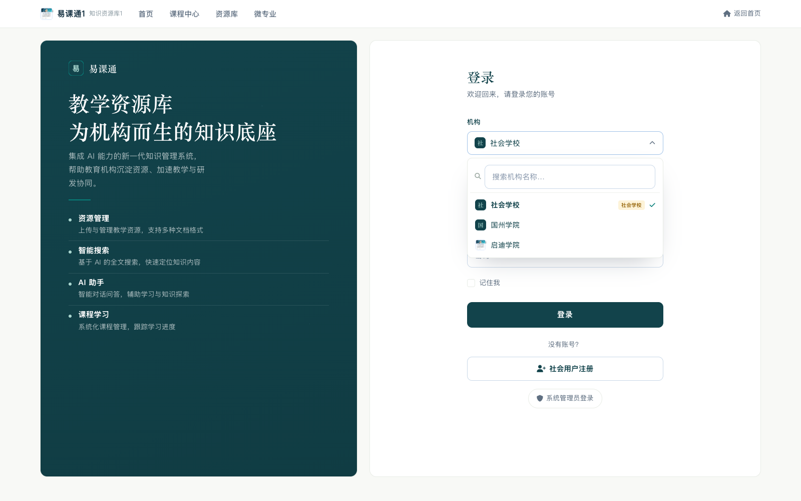

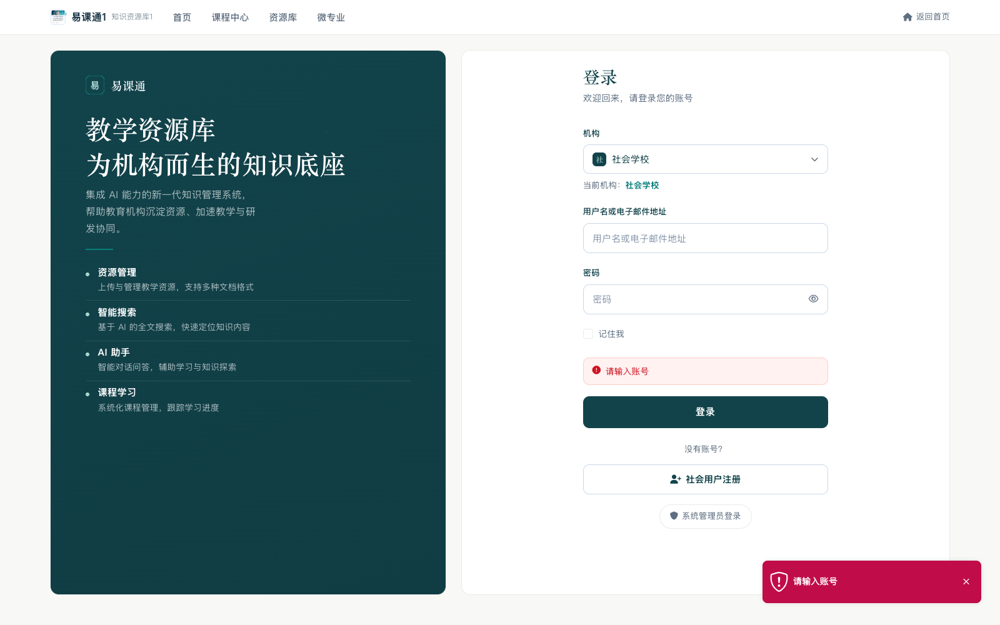

---

### #6 #7 #9 首页资源库卡片：整卡可点 / 等高对齐 / 缩略封面图 / 展示学校

**根因**：`app-library-card` 的宿主元素 `:host { display: block }` 没有 `height: 100%`，网格虽然把行高拉伸了，但卡片内部 `article` 不撑满 —— 这正是原截图里卡片高低不齐、顶部参差的原因。

**改动**

- `library-card.component.scss`
  - `:host { height: 100% }` + `.library-card { height: 100% }` → 同一行卡片**等高**；
  - 新增 `.library-cover`：固定 132px 高的封面图带，`object-fit: cover` **缩小**展示；无封面图时保留同高占位带，保证整排卡片顶部对齐；
  - 新增 `.library-school`（建设单位行）。
- `library-card.component.html`
  - 整卡 `role="link" tabindex="0"` + `(click)="enterLibrary()"`，`cursor: pointer`；
  - 卡片标题下新增学校行（校徽图标 + 学校名，点击跳学校简介）；
  - 课程链接改为 `openCourse()`：未登录 → 跳登录页（见 #8）。
- `LibraryCardVm` 新增 `schoolName` / `coverUrl`；后端 `TenantResourceSummaryDto` 新增 `LibraryName` / `SchoolName`，`CoverImage` 复用为封面图。

**验证**（脚本实测输出）

```
卡片 cursor = pointer
卡片高度 = 599, 599      ← 两张卡片等高、顶部对齐
```

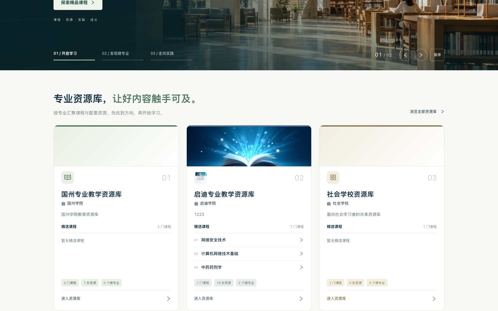

---

### #11 探索课程：删除「专业 / 资源库」筛选

**改动**：`explore.component.html` 中课程分区不再渲染「全部机构」「全部专业」下拉，只保留搜索框；`资源 / 微专业` 分区保留机构筛选（与需求范围一致）。

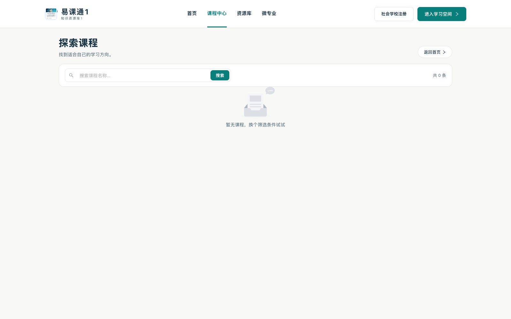

---

### #8 #9 资源库详情：建设单位 / 师资团队 + 课程点击跳登录

**改动**

- `tenant-homepage.component.ts`
  - 注入 `SchoolService`，加载学校档案 → `ownerName`（建设单位）/ `ownerLogo`；
  - 新增 `teachers` computed（已发布课程上去重后的授课教师 + 承担课程数）；
  - `handleCourseClick()`：**未登录直接跳登录页**（带 `returnUrl`），已登录保持原行为。
- `tenant-homepage.component.html/.scss`：简介区新增「建设单位 / 师资团队」信息行 + 独立「师资团队」卡片区。

**验证**（脚本实测）

```
跳转后 URL = http://localhost:4200/account/login?returnUrl=%2Fstudent%2Fcourses%2F3a2468d9-…
```


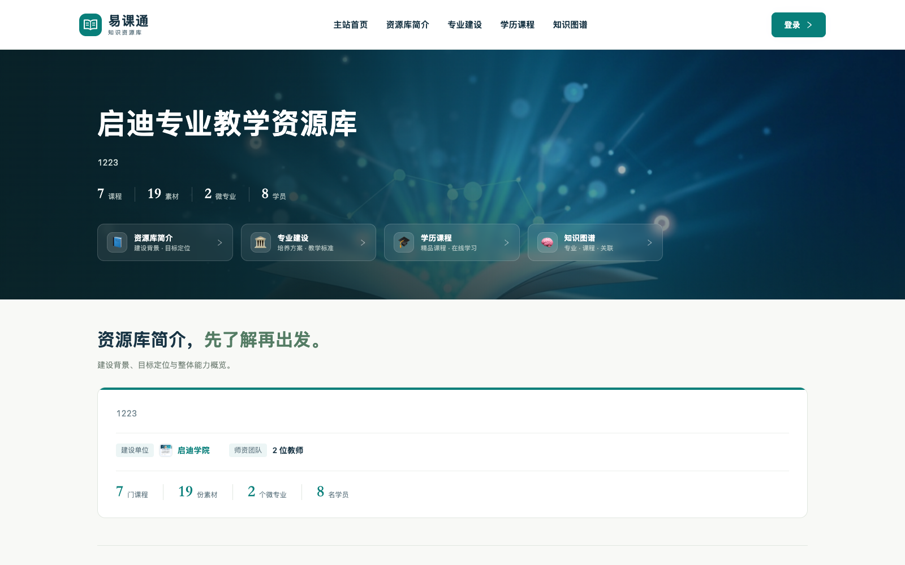


---

### #10 学校页面

已有 `/school/{tenantId}` 公开学校简介页（校徽 / 简介 / 专业设置 / 共建资源库 / 统计），本次验证留存截图。

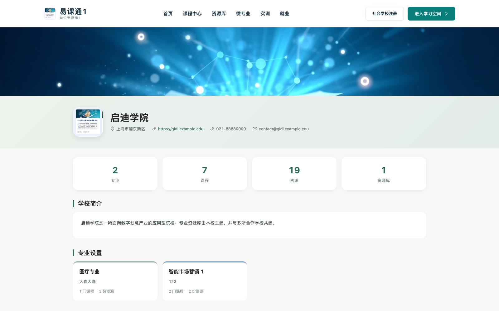

---

### #13 #14 游客访问微专业：不再显示学生空间、不再弹「登录已过期」

**改动**

- `student-layout.component.html/.ts`
  - 侧边栏按登录态分流：登录用户显示「机构卡片 + 学习空间 + 成长与服务」；游客显示「公开浏览」精简导航 + 登录/注册入口；
  - 面包屑游客显示「公开浏览 / xx」，不再显示「学生空间」。
- `auth-recovery.interceptor.ts`
  - 新增 `hasAnyToken()`：**没有任何 token 的匿名访客**收到 401 时直接透传错误，不再调 `setAuthError` 弹「登录已过期」；已登录用户过期仍照常弹窗。

**验证**（脚本实测）

```
登录已过期弹窗数量 = 0
侧边栏含「空间」= false
```

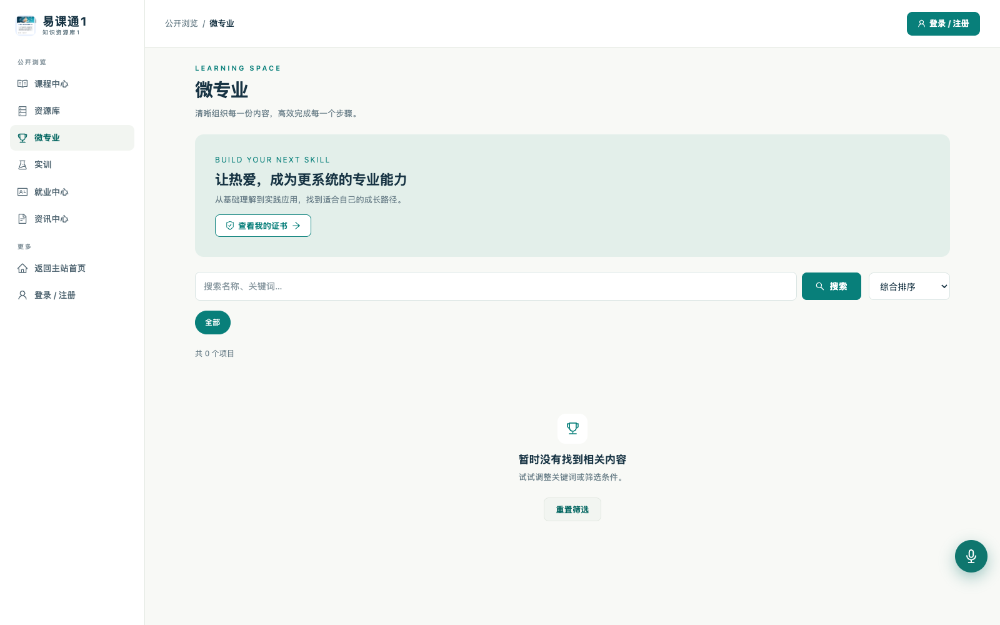

---

### #12 发布课程加「共享课」标签，所有注册用户都能学习

这是本次唯一涉及**数据模型 + 数据库迁移**的需求。

**后端**

| 改动 | 说明 |
|---|---|
| `Course.IsShared`（新增属性 + `SetIsShared`） | 共享课标记落库 |
| `PublishCourseInput { IsShared }`（新增 DTO） | 发布入参 |
| `CourseAppService.PublishAsync(Guid id, PublishCourseInput input)` | 勾选「共享课」→ 置 `IsShared=true` + 自动向平台「社会学校」租户建 `CourseShare`；社会学校未配置时抛明确中文异常 |
| `CourseAppService.EnrollAsync` | 跨租户选课闸门：**仅当课程已共享给当前租户时放行**，否则仍拒绝 |
| `CourseDto` / `CourseBriefDto` / `PublicCourseDto` 新增 `IsShared` | 供前端渲染「共享课」标签 |
| 迁移 `20261024190000_AddCourseSharedTag` | `AppCourses` 增加 `IsShared boolean NOT NULL DEFAULT false` |

**前端**：发布弹窗从 `nzModalService.confirm` 改为独立 `nz-modal`，带「共享课」勾选项 + 说明文案；课程列表与公开课程卡片渲染「共享课」标签。

**验证**（端到端实测）

```bash
# 1) 国州学院教师发布为共享课 → 自动共享到社会学校（启迪学院）
select "Note","SourceTenantId","TargetTenantId" from "AppCourseShares";
  发布为共享课 | 3a23961d-…(国州) | 3a2034d1-…(启迪=社会学校)

# 2) 社会学校注册用户选这门跨校共享课 → 成功
POST /api/app/course/enroll/{courseId}   → HTTP 204
AppStudentCourses: TenantId=3a2034d1-…(启迪) CourseId=3a247fb5-… Status=0

# 3) 反向校验：未共享的跨校课程仍然被拒
POST /api/app/course/enroll/{未共享课程Id} → HTTP 403
  message = 不能跨租户选课，该课程属于其他院校
```

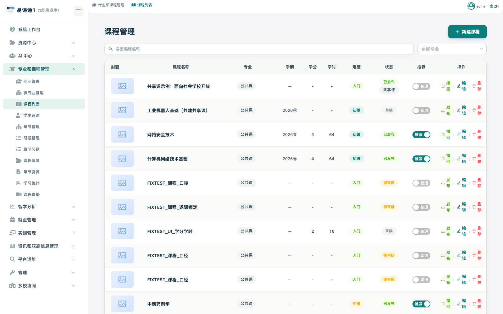

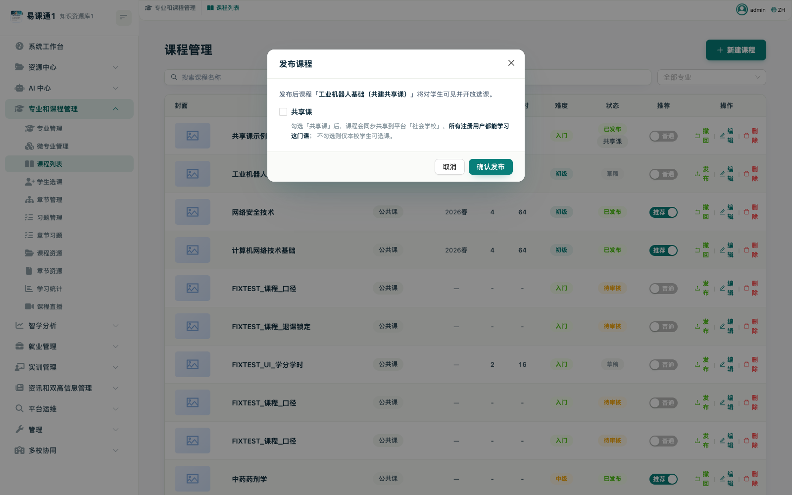

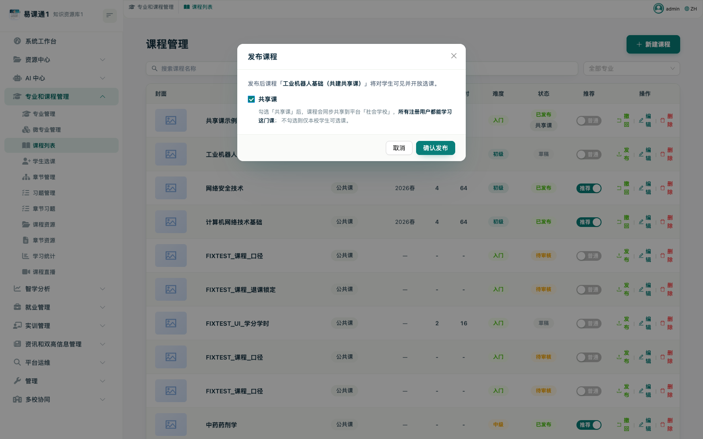

---

### #1 #2 多校共建 + 一租户多资源库（管理端）

**改动（随路修复）**：建库弹窗内容此前**渲染为空**（两个原因叠加）——

1. `nz-modal` 内容未用 `*nzModalContent` 包裹 → 内容不渲染；
2. `<label nz-checkbox [(ngModel)] name="isPublic">` 在 `<form>` 内触发 `NG01203`（无 value accessor）→ 整个表单创建失败。

修复后新建资源库成功入库。共建名单里的学校名也改为中文（不再显示 `qidi` / `guozhou` 这类租户 slug）。

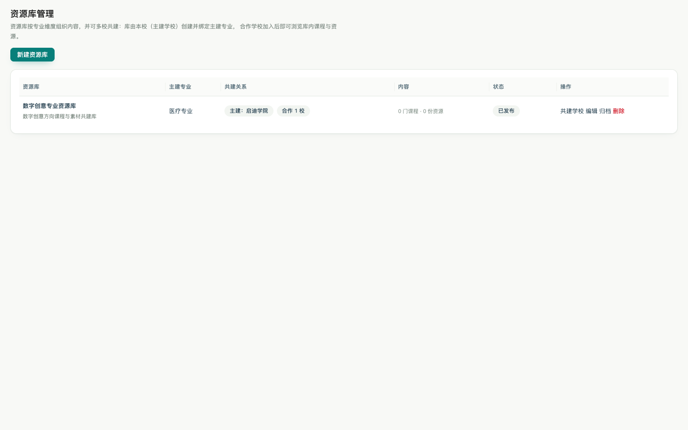

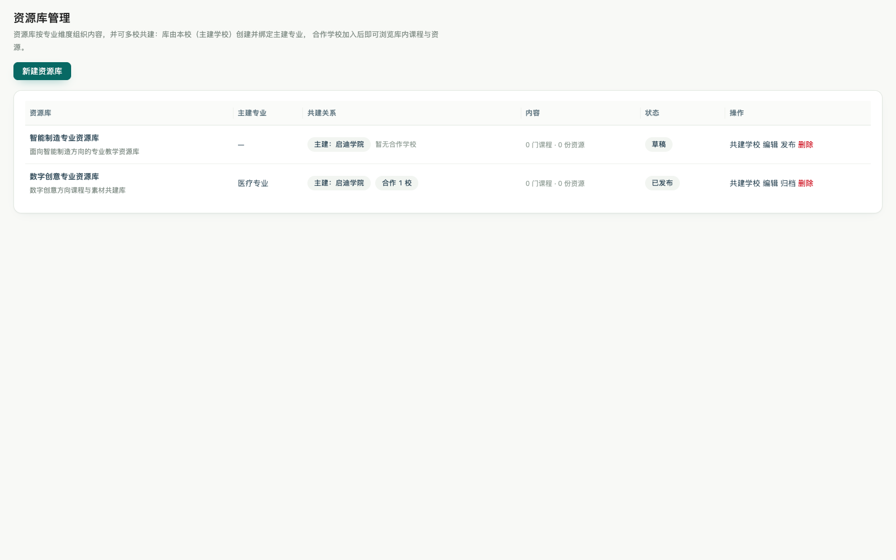

---

### #15 学校独立域名

**改动（随路修复）**：学校设置弹窗同样存在 `nz-checkbox` + `name` 导致的渲染失败，已修复；否则**租户管理员根本无法保存自有域名**。

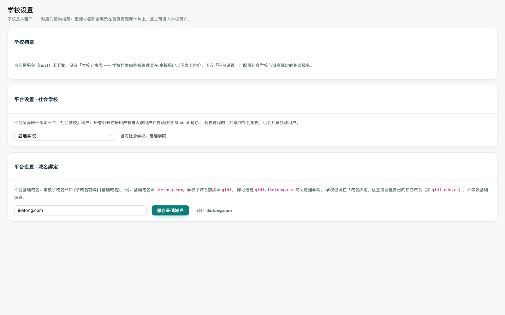

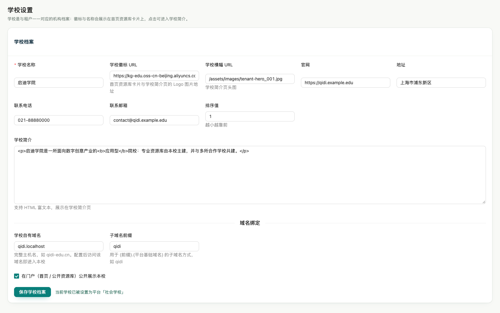

**验证**（按 Host 头模拟学校域名访问）

```bash
# 学校域名 → 只显示本校
curl -sk -H "Host: qidi.localhost" .../api/public/current-tenant
  {"isSchoolDomain":true,"tenantId":"3a2034d1-…","schoolName":"启迪学院",
   "domain":"qidi.localhost","slug":"qidi","baseDomains":["iketong.com"]}
curl -sk -H "Host: qidi.localhost" .../api/app/portal/public-tenant-list   → count = 1

# 平台域名 → 全平台
curl -sk .../api/app/portal/public-tenant-list                            → count = 2
```

---

## 四、社会学校：统一认证布局 + 社会学生登录

> 本轮追加需求（1023 之后）：注册页与登录页共用一套 layout（表单在右侧）；
> 社会学校的学生怎么登录。

### 4.1 统一认证布局（`app-auth-shell`）

登录页与注册页原本是两套完全不同的页面：登录页是「左侧品牌区 + 右侧表单」两栏，注册页是居中的单张白卡。

**做法**：把整站导航栏 + 左侧品牌区 + 右侧表单卡片 + 页脚抽成共享组件
`angular/src/app/shared/auth/auth-shell.component.ts`，登录页与注册页只提供各自的中段表单内容。

| 文件 | 变更 |
|---|---|
| `shared/auth/auth-shell.component.ts` / `.html` / `.scss` | **新增**：认证页外壳；`title` / `subtitle` / `heroTitle` / `heroDesc` 为输入 |
| `login/login.component.html` | 改为 `<app-auth-shell>` 内容投影，删除页面级 topbar / brand-panel / footer |
| `login/login.component.scss` | 删掉已迁走的布局样式（导航栏 / 两栏 / 页脚 / 响应式），只留表单控件样式 |
| `register/register.component.html` / `.scss` | 改用同一外壳；注册页保留「社会学校标识 + 表单」内容 |


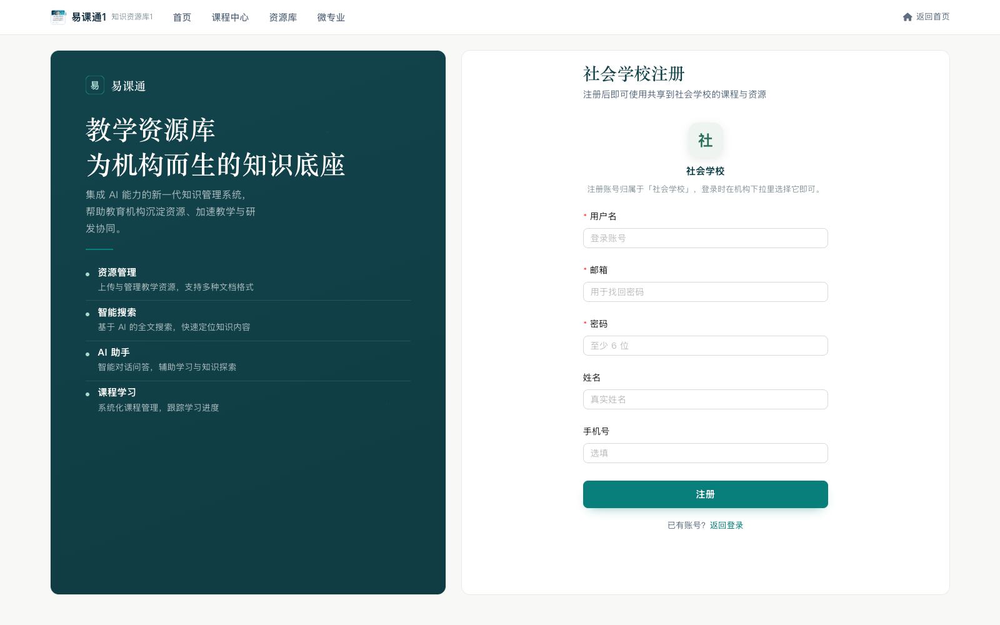

---

### 4.2 社会学校的学生怎么登录

**结论：社会学校本身就是一个租户**（平台唯一，配置项 `KnowledgeHub.PublicSchool.TenantId`）。
公开注册的用户被建在这个租户下、���授予 `Student` 角色；登录时在「机构」下拉里选中它即可 ——
和其他学校一样的租户登录流程，只是它被单独标记出来了。

**改动**

| 层 | 变更 |
|---|---|
| 后端 `TenantListController` | `TenantInfoDto` 新增 `IsPublicSchool`；`/api/public/tenants` 按平台配置标记出社会学校 |
| 后端 `SchoolProvisioningHandler` | 建校档案时优先用专业库中文名，避免落成租户 slug |
| 前端登录页 | 机构下拉里社会学校**置顶 + 「社会学校」标记**；`?tenant=<id>` 支持预选机构 |
| 前端注册页 | 「去登录」带上 `?tenant=<社会学校 Id>` → 登录页自动选中社会学校 |
| 前端学生端侧边栏 | 机构卡片改用学校档案的中文名（此前显示 `social` 这类 slug） |
| 前端课程中心 | 新增「全部课程 / 共享给我的课程」切换 —— 社会学生能看到共享到社会学校的课 |
| 后端 `PortalAppService` | 共享到本机构的课程并入首页/租户首页的课程列表与计数 |

**验证**（端到端实测）

```bash
# 1) 注册 → 账号落在社会学校租户，带 Student 角色
select u."UserName", u."TenantId", r."Name" from "AbpUsers" u
  join "AbpUserRoles" ur on ur."UserId"=u."Id" join "AbpRoles" r on r."Id"=ur."RoleId"
 where u."UserName" like 'social_demo%';
  social_demo_73630 | 3a247fe5-…(社会学校) | Student

# 2) /api/public/tenants 标记出社会学校
  3a247fe5  社会学校  isPublicSchool=True
  3a2034d1  启迪学院  isPublicSchool=False
  3a23961d  国州学院  isPublicSchool=False

# 3) 共享给我的课程 → 社会学生可见（total=2）
GET /api/app/course-share/shared-to-me  →  total = 2

# 4) 跨校选课（共享课）→ 成功
POST /api/app/course/enroll/{sharedCourseId}  →  HTTP 204
```

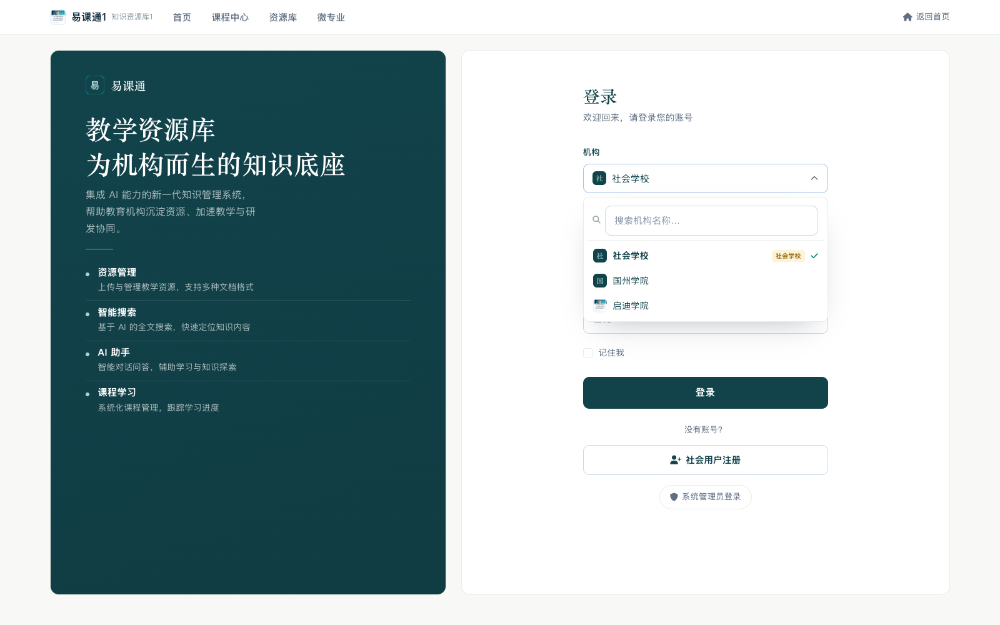

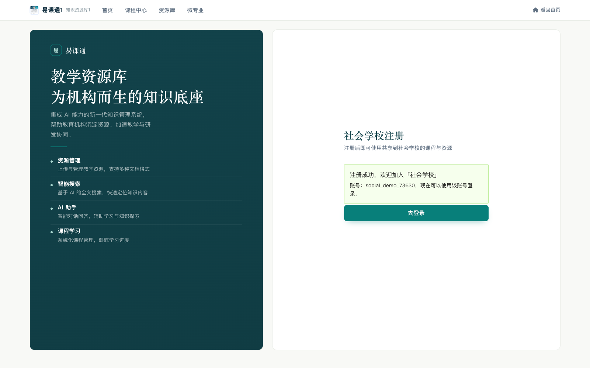

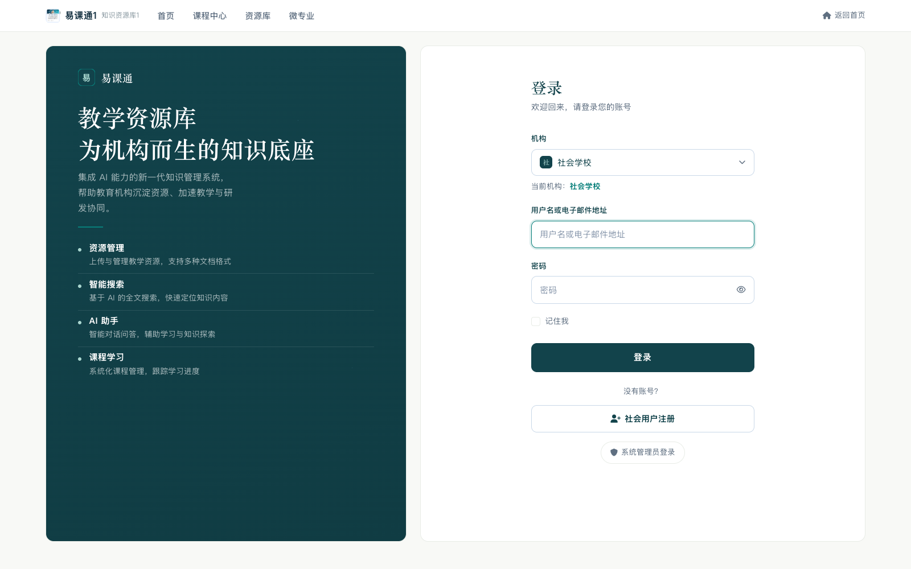

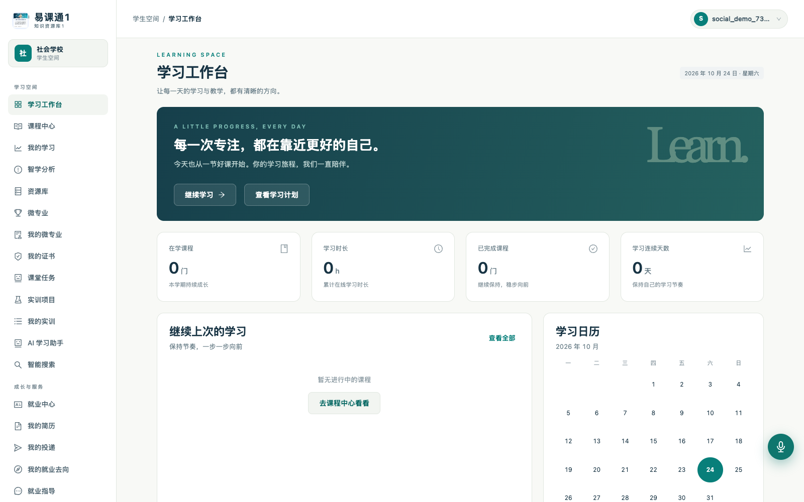

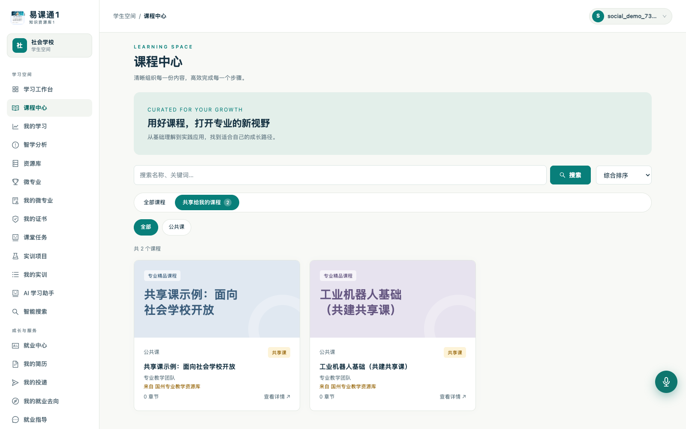

**顺路修掉的两个既有缺陷**

- `briefcase` / `clock` 不是本项目 ng-zorro 图标集里的名字（`nzType` 会拼成 `briefcase-o` / `clock-o`），
  学生端控制台一直报「icon does not exist」→ 换成 `idcard` / `clock-circle`。
- 「共享到社会学校的课程」此前**只有后端接口、没有任何界面入口**（`course-share.shared-to-me` 从未被前端调用），
  社会学生登录后课程中心是空的 —— 共享功能等于白做。本次在学生端课程中心补上入口。

---

## 五、随路修复的既有缺陷（不在 17 条内，但阻塞上述需求）

### F1. 平台门户被 `__tenant` cookie 错误收窄为单校

**现象**：登录页选机构后会写 `__tenant` cookie，之后平台域名下的首页资源库只显示**一所学校**（客户截图里首页有 5 张卡片，说明线上未触发；本地必现）。

**根因**：`PortalAppService.GetScopeTenantsAsync()` / `TenantListController.GetCurrentTenant()` / `SchoolDomainTenantGuardMiddleware` 都用
`ITenantResolveResultAccessor.Result.AppliedResolvers.Contains("SchoolDomain")` 判断「是否学校域名」。

但 **ABP 的 `TenantResolver` 会把每一个尝试过的解析器名字都记进 `AppliedResolvers`**（不管它是否真的解析出租户）——学校域名解析器注册在链首，所以该判断**恒为真**。

**修复**：新增 `ISchoolDomainContext`（`src/KnowledgeHub.Application/Schools/SchoolDomainContext.cs`），改为**看当前请求的 Host 能否解析出某所学校**（与域名解析器同一套规则），三处调用点全部改用它。

```bash
# 修复前：带 __tenant cookie → 门户只剩 1 校，且 isSchoolDomain 误报 true
# 修复后：
curl -sk -H "Cookie: __tenant=3a23961d-…" .../api/public/current-tenant
  {"isSchoolDomain":false,…}
curl -sk -H "Cookie: __tenant=3a23961d-…" .../api/app/portal/public-tenant-list   → count = 2
```

### F2 / F3. 两处 `nz-modal` 内容渲染失败

| 位置 | 影响 |
|---|---|
| `admin/libraries/resource-library-management.component.html` | 建库/改库弹窗空白 → **一租户多资源库根本建不了**（#2） |
| `admin/school/school-management.component.html` | 学校档案弹窗空白 → **学校自有域名存不进去**（#15） |

修复：内容加 `*nzModalContent` 包裹 + `ngModel` 控件改 `standalone`（组件用的是普通对象，不是响应式表单）。

顺带修正了全项目另外 2 处同样漏包裹的弹窗：`admin/storage-monitor`、`practicum/my-practicum`。
（扫描口径：`<nz-modal` 数量 vs `*nzModalContent` 数量，已全部配平。）

---

## 六、验证方法与结果

| 项 | 方法 | 结果 |
|---|---|---|
| 后端编译 | `dotnet build src/KnowledgeHub.HttpApi.Host/…csproj` | ✅ 0 错误（689 警告，均为改动前既有） |
| 前端编译 | `npx ng build --configuration development` | ✅ 通过 |
| 数据库迁移 | `./dev.sh migrate` | ✅ `20261024190000_AddCourseSharedTag` 成功应用 |
| API 健康 | `curl -sk https://localhost:44305/health-status` | ✅ Healthy |
| EF 模型一致性 | `dotnet ef migrations has-pending-model-changes` | ✅ No changes |
| 浏览器实测 | Playwright（Chrome，1600×1000）脚本化走查 | ✅ 17 条需求逐条留证，脚本输出见上文 |

截图脚本已入库，可复现：

```
scripts/issue-1023/shots.cjs              # 游客视角（登录页/首页/探索/详情/微专业）
scripts/issue-1023/shots-admin.cjs        # 宿主管理端
scripts/issue-1023/shots-tenant-admin.cjs # 租户管理端（资源库/学校设置）
scripts/issue-1023/shots-teacher.cjs      # 教师端（发布共享课）
```

### 演示数据调整（仅为本地验证展示效果）

| 表 | 改动 | 原因 |
|---|---|---|
| `AppSchools` | guozhou → 「国州学院」 | 需求「机构名称要用中文」，原为租户 slug |
| `AppTenantInfos` | → 「国州专业教学资源库」/「启迪专业教学资源库」 | 同上 |
| `AbpUsers` | guozhou-teacher/admin → 「国州 老师/管理员」 | 同上（教师名） |
| `AppResourceLibraries` | 新增「智能制造专业资源库」（草稿） | 验证 #2「一租户多资源库」 |
| `AppCourses` | 新增「共享课示例：面向社会学校开放」 | 验证 #12 共享课链路 |
| `AbpTenants` | 新增租户 `social`（学校档案名「社会学校」） | 演示「平台唯一社会学校」独立成租户 |
| `AbpSettings` | `KnowledgeHub.PublicSchool.TenantId` → 社会学校租户 | 演示社会学校独立于各院校 |

---

## 七、变更文件清单

### 后端（`src/`）

| 文件 | 变更 |
|---|---|
| `KnowledgeHub.Domain/Courses/Course.cs` | 新增 `IsShared` + `SetIsShared` |
| `KnowledgeHub.Domain/Schools/SchoolProvisioningEnsureHostedService.cs` | 建校档案优先用专业库中文名；存量英文名自愈 |
| `KnowledgeHub.Application/Schools/SchoolDomainContext.cs` | **新增**：按 Host 判断是否为学校域名 |
| `KnowledgeHub.Application/Courses/CourseAppService.cs` | 发布支持共享课标签 + 跨租户选课闸门按共享放开 |
| `KnowledgeHub.Application/Courses/PortalAppService.cs`（`Portal/PortalAppService.cs`） | 租户范围按学校域名判定；资源库摘要补 `LibraryName`/`SchoolName`、中文名解析 |
| `KnowledgeHub.Application/ResourceLibraries/ResourceLibraryAppService.cs` | 主建方/成员显示中文机构名 |
| `KnowledgeHub.Application.Contracts/Courses/Dtos/CourseDtos.cs` | `CourseDto.IsShared` + 新增 `PublishCourseInput` |
| `KnowledgeHub.Application.Contracts/Courses/ICourseAppService.cs` | `PublishAsync` 增加入参 |
| `KnowledgeHub.Application.Contracts/Portal/IPortalAppService.cs` | `TenantResourceSummaryDto` 增 `LibraryName`/`SchoolName`；`CourseBriefDto`/`PublicCourseDto` 增 `IsShared` |
| `KnowledgeHub.HttpApi/Controllers/TenantListController.cs` | 租户列表返回中文机构名 + 校徽 + `IsPublicSchool` 标记 |
| `KnowledgeHub.Domain/Schools/SchoolProvisioningHandler.cs` | 建校档案优先用专业库中文名 |
| `KnowledgeHub.HttpApi.Host/Tenancy/SchoolDomainTenantGuardMiddleware.cs` | 改用 `ISchoolDomainContext` 判定 |
| `KnowledgeHub.EntityFrameworkCore/Migrations/20261024190000_AddCourseSharedTag.cs`(+Designer) | **新增迁移**：`AppCourses.IsShared` |
| `KnowledgeHub.EntityFrameworkCore/Migrations/KnowledgeHubDbContextModelSnapshot.cs` | 快照同步 |

### 前端（`angular/src/app/`）

| 文件 | 变更 |
|---|---|
| `login/login.component.ts` / `.html` / `.scss` | 注册按钮、空值提醒、中文机构名、机构搜索框、校徽 |
| `home/shared/library-card.component.ts` / `.html` / `.scss` | 整卡可点、等高对齐、缩略封面图、学校行、课程点击跳登录 |
| `home/portal-home.component.ts` | 卡片 VM 补 `schoolName` / `coverUrl` |
| `home/explore/explore.component.ts` / `.html` / `.scss` | 删课程分区筛选、卡片字段、共享课标签样式 |
| `admin/tenant-info/tenant-homepage.component.ts` / `.html` / `.scss` | 建设单位 + 师资团队、课程点击跳登录 |
| `student/layout/student-layout.component.ts` / `.html` | 游客「公开浏览」外壳 |
| `core/auth/auth-recovery.interceptor.ts` | 匿名访客不弹「登录已过期」 |
| `learning/course-list/course-list.component.ts` / `.html` / `.scss` | 发布弹窗 +「共享课」标签 |
| `admin/libraries/resource-library-management.component.html` | **修**：弹窗内容渲染（`*nzModalContent` + standalone） |
| `admin/school/school-management.component.html` | **修**：弹窗内容渲染 |
| `admin/storage-monitor/storage-monitor.component.html` | **修**：弹窗内容渲染 |
| `practicum/my-practicum.component.html` | **修**：弹窗内容渲染 |
| `proxy/courses/course.service.ts` / `dtos/models.ts` | publish 带 body、新增 `PublishCourseInput`、`isShared` |
| `proxy/portal/models.ts` | `TenantResourceSummaryDto` 增字段、`PublicCourseDto.isShared` |
| `shared/auth/auth-shell.component.ts` / `.html` / `.scss` | **新增**：认证页共用外壳（导航栏 + 品牌区 + 表单卡片 + 页脚） |
| `register/register.component.ts` / `.html` / `.scss` | 改用统一外壳；「去登录」带 `?tenant=` 预选社会学校 |
| `student/courses/student-courses.component.ts` / `.html` / `.scss` | **新增**「全部课程 / 共享给我的课程」切换 + 共享课标记 |
| `proxy/controllers/models.ts` | `TenantInfoDto` 增 `schoolName`/`logoUrl`/`tenantName`/`isPublicSchool` |

---

## 八、遗留事项（未在本次改动内，建议后续排期）

1. **未勾「记住我」时刷新页面会掉线**（既有问题，本次未改）。
   `custom-auth.service.ts` 靠「`access_token` 是否存在且未过期」判断是否同一浏览器会话，但 ABP 的 `MemoryTokenStorageService` 把 access token 放在内存，页面刷新后取不到 → 误判为「浏览器重启」→ 删掉 `refresh_token` → 掉线。
   代码注释写的目标是「刷新页面保持登录、重启后需重新登录」，与实际行为不一致。修法需要引入一个跨刷新可读的会话标记（不能简单用 `sessionStorage`，它是 per-tab 的，会踩多标签页）。
   *（本次验证脚本勾选「记住我」后正常，故不影响上述截图与结论。）*

2. **`qidi-admin` 账号被锁**（本次验证中曾误试密码触发锁定阈值），已手工解锁并清零失败计数，生产/交付环境需注意账号状态。

3. **专业库简介仍是占位文本**（启迪学院为「1223」），属于演示数据，可由学校管理员在【租户资料】维护。
